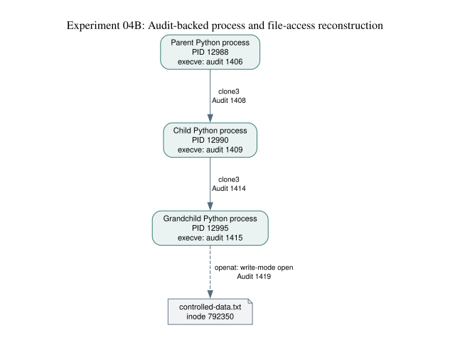

# Provenance-assisted incident investigation in SME environments

This is the laboratory notebook for my ongoing BTech Cybersecurity and Digital Forensics project at the British Columbia Institute of Technology (BCIT).

I am investigating a practical question: **can relationships between processes, files and security events help an analyst reconstruct an incident more reliably than a conventional SIEM timeline?** I am particularly interested in what remains possible when an organization has limited monitoring resources or some telemetry is missing.

The literature review and project proposal are still being revised. The experiments below are feasibility work, not a completed provenance-based intrusion detection system.

## Laboratory setup

I use two Ubuntu machines and a Wazuh virtual machine. One Ubuntu host runs KVM/libvirt and hosts the Wazuh manager, indexer and dashboard (version 4.14.9). The second host is used for controlled Linux experiments with a Wazuh agent, Falco and Linux Audit.

[Current lab architecture](02-docs/02-home-lab-architecture-map.md) · [Network setup](02-docs/01-network-architecture.md)

## Experiments so far

| Experiment | Question tested | Record |
| --- | --- | --- |
| [01 — Authentication](01-experiments/01-controlled-authentication/README.md) | Can I generate a controlled authentication event and find it in Wazuh? | Controlled event collection |
| [02 — Falco](01-experiments/02-falco-runtime/README.md) | Does Falco observe the selected runtime activity? | Runtime alert |
| [02B — Falco/Wazuh](01-experiments/02b-falco-wazuh-ingestion/README.md) | Can the Falco event be ingested and alerted on by Wazuh? | Integration test |
| [03 — Linux Audit](01-experiments/03-linux-audit-provenance/README.md) | What process and file relationships can I reconstruct from selected audit records? | Partial reconstruction |
| [04 — Process chain](01-experiments/04-process-file-provenance/README.md) | Can I capture process creation as well as execution and file access? | Parent–child–grandchild chain |

### Most recent experiment: 04 (4 November 2026)

A controlled Python parent created a child, which created a grandchild. The grandchild opened a test file in write mode. Six selected audit events (serials 1406, 1408, 1409, 1414, 1415 and 1419) support the reconstruction.

The `clone3` records make this stronger than my earlier Experiment 03F, where the process relationship relied on parent-process identifiers without a captured process-creation event. The `openat` event shows a successful file open with write flags; it does not, by itself, establish a completed write or byte-level information flow.

[Experiment 04 results](01-experiments/04-process-file-provenance/results.md) · [Method](01-experiments/04-process-file-provenance/methodology.md) · [Test script](01-experiments/04-process-file-provenance/scripts/process_chain.py)

## What I am working toward

My proposed study compares three approaches to investigating the same controlled attack scenarios: (A) conventional SIEM analysis, (B) SIEM with runtime-event correlation, and (C) provenance-assisted reconstruction. I plan to repeat comparisons with complete telemetry and controlled loss of approximately 10% and 25% of events.

The important methodological problem is to separate any benefit from **better analysis** from a benefit that comes simply from **collecting more events**. I have not yet run that comparison.

[Original research concept (plain text)](00-research/concept-map.txt) · [Research question and proposed study design](00-research/README.md) · [Illustrative SME environment](02-docs/00-sme-reference-architecture.md)

## Scope of the published material

This is an independent home lab, not a record of a company deployment. I publish selected methods, scripts and diagrams; raw audit exports and screenshots containing local identifiers are not included. Some older experiment notes refer to evidence retained privately, so not every local screenshot is available here.

I welcome technical criticism of the experimental design. Cheers!
